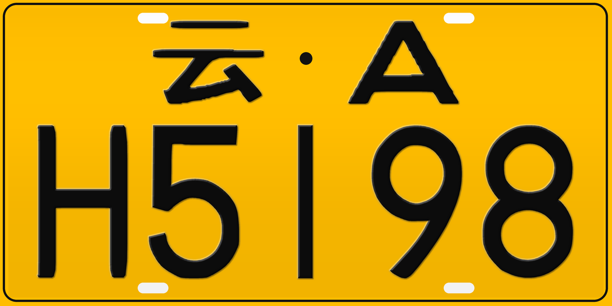

# PlateStudio 16K 高清车牌生成器

Windows 中文桌面工具，用于车牌图形设计预览、视觉研究和合成图像数据生成。
采用第二版字符造型、保留转角的数字平滑处理及可调压凸效果。



## 功能

- 自定义车牌号码，8 种底板类型；黄牌及普通白牌支持双层。
- 数字轮廓抗锯齿，保留原素材造型；原版外框。
- 立体压凸效果可开关，强度可调，默认 0.7。
- PNG 无损、JPG 高质量导出；宽度 440～16000 像素。
- 双层最大 16000 × 8000 像素；中文文件路径及 Ctrl+S 保存。
- 后台导出，减少重复绘制；PNG 使用快速无损压缩（文件可能稍大）。
- 使用已确认的压凸高光、侧边阴影和轻投影，强度可调。

## Windows EXE

从项目发布包解压后双击 `PlateStudio_16K_Fast.exe`。无需安装 Python，无需联网。
首次启动会解包资源，可能需要数秒。项目提供的是未签名的 Windows 64 位程序。

普通车牌输入 7 位字符，新能源输入 8 位，选择样式、单双层和宽度后导出。
输入小写字母自动转换为大写，分隔点、空格及短横线会被去除。
推荐 PNG；查看清晰度请以导出文件 100% 比例查看，窗口预览会缩小。
16K 导出占用更多内存与时间，可先使用 3840 或 7680 宽度确认效果。

## 从源码运行

需要 Windows 10/11 64 位和 Python 3.12，安装包含 Tcl/Tk 的 Python。

```powershell
python -m venv .venv
.\.venv\Scripts\python.exe -m pip install -r requirements.txt
.\.venv\Scripts\python.exe src/plate_studio.py
```

## 构建单文件 EXE

```powershell
powershell -ExecutionPolicy Bypass -File .\build.ps1
```

构建脚本创建 `.venv`、安装锁定版本依赖并运行 PyInstaller；产物位于 `dist/PlateStudio_16K_Fast.exe`。
首次构建需要联网下载依赖。EXE 不提交到源码仓库，建议作为 GitHub Release 附件发布。

## 验证

```powershell
.\.venv\Scripts\python.exe src/plate_studio.py --self-test work/self-test
```

生成 9 张测试图及 JSON，覆盖 8 种底板和单双层组合。
当前交付版本已验证打包 EXE 的素材加载，并成功导出 16000 × 8000 PNG。
本机 7680 像素双层 PNG 测试从 4.24 秒降至 3.38 秒，具体耗时随机器和参数变化。

## 限制与免责声明

软件只检查字符素材、长度和样式组合，不校验号码登记、真实性或合法性。
视觉效果是二维模拟，车牌尺寸比例、字符和标志不保证符合任何官方制作标准。
数字形状来源于原始位图素材；更高像素提供清晰边缘，不增加真实物理细节。
新能源原低清标志以圆点替代。

**本项目不制作、签发或认证真实机动车号牌。不得将生成图片用于伪造号牌、
冒用身份、欺诈、规避交通执法或其他违法活动。使用者应遵守所在地法律法规。**
使用本项目即应阅读完整 [免责声明](DISCLAIMER.md)。本声明不能排除法律规定的责任。

## 来源与授权

基于 [Pengfei8324/chinese_license_plate_generator](https://github.com/Pengfei8324/chinese_license_plate_generator)
的字符素材、排版方法和功能思路进行桌面改编。
原项目 MIT License，Copyright (c) 2020 leijd。完整许可见 [LICENSE](LICENSE)。
原版权和许可声明在源码及发布包中保留。改编内容按相同 MIT 条款提供。
详见 [第三方说明](THIRD_PARTY_NOTICES.md)。

